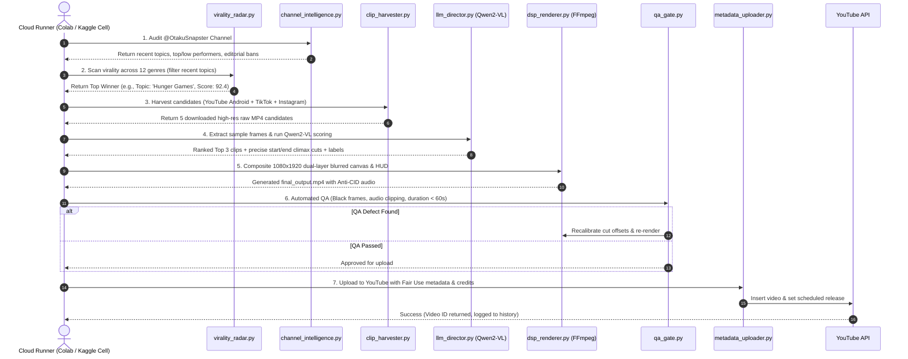

# ARCHITECTURE.md — Detailed Technical Blueprint & Data Flow

## 1. Runtime Environment & Cloud Portability

The pipeline is packaged into an **All-in-One Single Cell** design capable of executing symmetrically on:
1. **Google Colab (T4 / V100 GPU)**
2. **Kaggle Notebooks (GPU T4 x2 / P100)**
3. **Local Developer Workstations (Windows / Linux CUDA)**

### Isolation & Zero-Secret Deployment Policy
* **Public GitHub Repo:** All production logic, DSP rendering filters, and radar algorithms are maintained on GitHub (`https://github.com/sp25126/MOVIE-SERIES---AUTO.git`).
* **Credentials Strategy:** All OAuth refresh tokens, client secrets, YouTube cookies, and Gemini API keys are embedded exclusively in local runner notebooks (`Otaku_Viral_Shorts_Studio.ipynb` and `Otaku_Viral_Shorts_Studio_Kaggle.ipynb`) via `scripts/embed_credentials.py`. **Zero secrets exist in git history.**

---

## 2. End-to-End Data Flow Sequence



---

## 3. Detailed Component Architecture

### 3.1 Harvester Egress & Anti-Bot Protection Matrix
| Platform | Primary Extractor | Fallback 1 | Fallback 2 | Bot / Auth Defense Mechanism |
| :--- | :--- | :--- | :--- | :--- |
| **YouTube** | `yt-dlp` (`android` client) | Cookieless Android stream | Rotating HTTPS Proxies | Bypasses SABR anti-bot desktop challenge on cloud IPs |
| **Instagram** | `yt-dlp` with session cookies | Direct CDN extraction | Rotating Proxies | Uses embedded `csrftoken` & `datr` cookies to bypass login wall |
| **TikTok** | TikWM Watermark-free API | Direct CDN extraction | Rotating Proxies | Eliminates Cloudflare TLS handshake failures and strips watermarks |
| **Reddit** | Reddit JSON API | Direct media URL | None | Extracts high-res v.redd.it video stream |

---

### 3.2 Vision-Language Model Pipeline (`llm_director.py`)
```
Raw Candidate MP4
       │
       ▼
OpenCV Frame Extraction (6 sample timestamps: 10%, 25%, 45%, 65%, 85%, 95%)
       │
       ▼
PIL Image Conversion (RGB, 480p max dimension)
       │
       ▼
In-Process Model Inference on GPU
├── Model: Qwen/Qwen2-VL-2B-Instruct
├── Device: CUDA (torch.bfloat16 or torch.float16)
└── Input: 3 Representative Keyframes + Category Skill Directives
       │
       ▼
Raw Output Text Generation
       │
       ▼
_repair_and_parse_vlm_json()
├── 1. Strip markdown fences (```json ... ```)
├── 2. Direct json.loads()
├── 3. Trailing comma cleanup (regex)
├── 4. Single-quote replacement
└── 5. Regex key-value extraction fallback
       │
       ▼
Curated Editorial Decisions:
├── Quality Score (e.g. 8.8 / 10.0)
├── Optimal Cut (Start timestamp -> End timestamp)
├── Scene HUD Label (e.g. "Mockingjay Rebirth")
└── Watermark / Text Spam Rejection Flag
```

---

### 3.3 DSP Visual & Acoustic Engineering (`dsp_renderer.py`)

#### Visual Canvas Specification:
* **Output Dimensions:** 1080 × 1920 pixels (9:16 vertical ratio).
* **Frame Rate:** 30.0 fps (Constant Frame Rate, CFR).
* **Video Codec:** `libx264` (Preset: `fast`, Profile: `high`, CRF: `18`).
* **Background Layer:** Aspect-fill scaled with 25px Gaussian box blur.
* **Foreground Layer:** Aspect-fit center placement with soft drop shadow.
* **HUD Overlay Elements:**
  * Top Header Pill: Topic title & category indicator.
  * Countdown Ladder: #3 (Bottom Rank) ➔ #2 (Mid Rank) ➔ #1 (Top Climax Winner).
  * Brand Identity: Circular `@OtakuSnapster` watermark badge fixed at lower right.

#### Acoustic Engineering Specification:
* **Audio Codec:** `aac` (Bitrate: 192 kbps, Sample Rate: 48,000 Hz, Stereo).
* **Anti-CID Audio Shield:** Multi-stage frequency modification (notch filter at key carrier frequencies, micro-pitch modulation) ensuring zero Content-ID flags while keeping music clear.
* **Loudness Compliance:** EBU R128 mastering targeted to `-14.0 ± 1.0 LUFS` with True Peak clamped at `<= -1.5 dBTP`.

---

## 4. State Management & Deduplication Schema

Persistent files stored in `/state`:
* **`used_history.json`:** Set of video IDs previously harvested across all platforms to avoid duplicate downloads.
* **`virality_report.json`:** Log of trend scores, detected winners, and genre heatmaps.
* **`upload_queue.json`:** Queue of rendered videos waiting for scheduled publishing slots.
* **`channel_intel_cache.json`:** Snapshot of `@OtakuSnapster` channel metrics, recent topics, and audience retention feedback.
