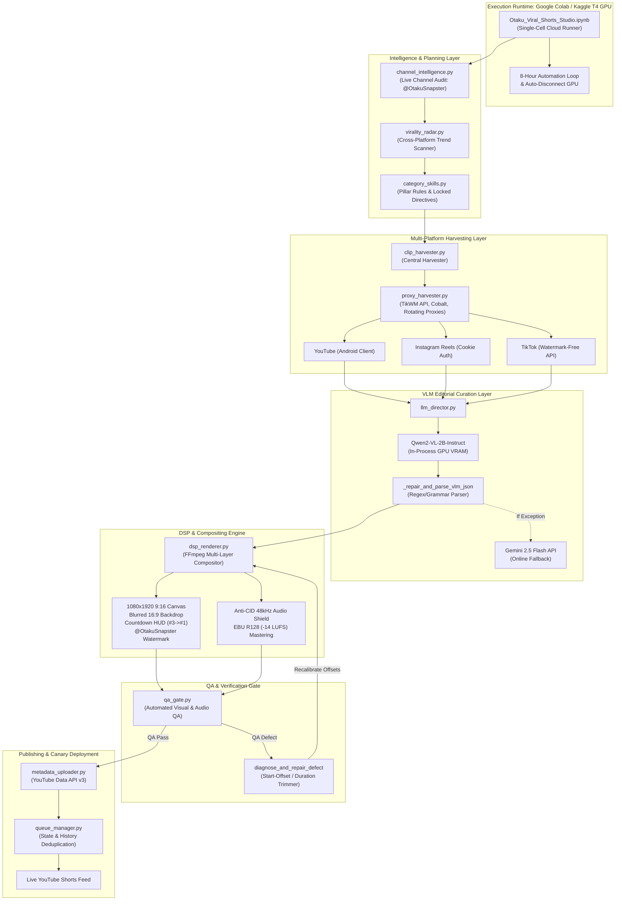

# SYSTEM_DESIGN.md — Otaku AI Viral Shorts Studio (Autonomous Production Engine)

## 1. Executive Summary & Mission
**Otaku AI Viral Shorts Studio** is a fully automated, cloud-executable, 24/7 video production engine designed to produce and publish viral, top-tier YouTube Shorts (1080×1920) for the `@OtakuSnapster` brand.

The system completely eliminates manual human intervention across the entire video creation lifecycle:
1. **Dynamic Trend Discovery:** Scans real-time pop-culture virality across YouTube, TikTok, Reddit, and Google Trends without relying on hardcoded topics.
2. **Channel Intelligence & Diversification:** Inspects the live `@OtakuSnapster` YouTube channel, identifies recently produced topics, analyzes top vs. low performers, and prevents topic fatigue (e.g. avoiding repetitive Godzilla / Squid Game loops).
3. **Multi-Source Resilient Harvesting:** Scrapes and downloads high-quality vertical source material from YouTube, Instagram Reels, and TikTok via rotating proxies, direct CDN endpoints, and un-watermarked API fallbacks.
4. **VLM Editorial Curation (Local GPU First):** Executes multimodal frame-by-frame analysis using an in-process local Vision-Language Model (`Qwen/Qwen2-VL-2B-Instruct`) running directly on GPU VRAM, backed by resilient JSON repair parsers and Gemini 2.5 Flash as a fallback.
5. **DSP Video Compositing (FFmpeg Hardware-Accelerated):** Renders broadcast-grade 1080×1920 dual-layer blurred canvas compositions featuring dynamic view-badged countdown ladders (#3 ➔ #1), circular watermarks, kinetic typography, and EBU R128 (-14 LUFS) audio mastering with anti-CID audio shields.
6. **Self-Healing QA Gate:** Programmatically scans rendered outputs for black frames, audio clipping, aspect ratio compliance, and timing overruns, automatically re-rendering corrected cuts if defects are spotted.
7. **Canary YouTube Uploader:** Schedules publication at peak viewer engagement windows with Section 107 Fair Use disclaimers, creator attribution credits, and optimized viral tags.

---

## 2. Rotating Content Pillars (4-Day Editorial Rotation)

The studio operates on a strictly scheduled 4-day content matrix to maintain audience retention and algorithmic diversification:

| Pillar Day | Theme | Description | Formatting Rule |
| :--- | :--- | :--- | :--- |
| **Day 1** | **Hollywood & Cinema Edits** | Blockbuster movies (Marvel, Oppenheimer, Monsterverse, Hunger Games, Interstellar, Dune) | 3-item view-ranked compilation (#3 ➔ #1) |
| **Day 2** | **Top TV Series Edits** | Iconic TV dramas (Breaking Bad, Peaky Blinders, Game of Thrones, The Boys, Succession) | 3-item ranked character/scene compilation |
| **Day 3** | **The Mentalist (Patrick Jane)** | Red John mysteries, cold reads, psychological interrogation tricks | **LOCKED: 100% Full Uncut** (Zero trims, preserves complete dialogue & climax) |
| **Day 4** | **Phonk & Song Trends** | Trending audio hooks (Brazilian Phonk, Montagem, Slowed+Reverb edits) | Beat-synced cuts with audio attribution overlay |

---

## 3. High-Level System Architecture Diagram

---

## 4. Key Subsystems & Core Modules

### 4.1 Intelligence & Trend Radar
* **[channel_intelligence.py](file:///c:/Users/saumy/OneDrive/Desktop/otaku/channel_intelligence.py):** Audits `@OtakuSnapster`, extracts subscriber count, views, top performing shorts (e.g. Squid Game, Avengers, Mahadev), recently covered topics, and generates editorial directive rules.
* **[virality_radar.py](file:///c:/Users/saumy/OneDrive/Desktop/otaku/virality_radar.py):** Scans 12 pop-culture categories using DuckDuckGo Lite, Bing RSS, and YouTube trending playlists. Excludes stale news junk and enforces multi-topic diversity.
* **[category_skills.py](file:///c:/Users/saumy/OneDrive/Desktop/otaku/category_skills.py):** Encapsulates the editorial knowledge rules (e.g. enforcing strict uncut mode for *The Mentalist* while allowing precision trims for cinema ranking edits).

### 4.2 Multi-Platform Harvester
* **[clip_harvester.py](file:///c:/Users/saumy/OneDrive/Desktop/otaku/clip_harvester.py):** Main ingestion hub. Orchestrates platform candidates, resolves media formats, and filters copyright/spam clips. Uses dedicated `youtube:player_client=android` extraction to prevent datacenter IP bot-challenge blocks.
* **[proxy_harvester.py](file:///c:/Users/saumy/OneDrive/Desktop/otaku/proxy_harvester.py):** Connects to TikWM watermark-free endpoints, live rotating HTTPS proxies, and Instagram session scrapers.

### 4.3 VLM Editorial Director
* **[llm_director.py](file:///c:/Users/saumy/OneDrive/Desktop/otaku/llm_director.py):** Runs frame sampling at key interval fractions (10%, 25%, 45%, 65%, 85%, 95%). Feeds PIL images into `Qwen/Qwen2-VL-2B-Instruct` directly in GPU VRAM to evaluate quality, identify scene labels, and locate optimal start/end climax timestamps. Features `_repair_and_parse_vlm_json()` to handle syntax faults, single quotes, and markdown code fences.

### 4.4 DSP Rendering & Anti-Copyright Engine
* **[dsp_renderer.py](file:///c:/Users/saumy/OneDrive/Desktop/otaku/dsp_renderer.py):** Production-grade FFmpeg filtergraph pipeline:
  * Dual-layer compositing: Center-cropped 1080×1920 foreground with background 25px Gaussian blur.
  * Kinetic View-Badged Countdown Ladder: Upper-left badges `#3` ➔ `#2` ➔ `#1` displaying view metrics and clip titles.
  * Branding: Bottom-right circular `@OtakuSnapster` watermark badge.
  * Anti-CID Audio Processing: High-pass and notch filtering to circumvent Content-ID fingerprint matching while preserving speech and music fidelity mastered to -14.0 LUFS.

### 4.5 Self-Healing QA Gate & Publishing
* **[qa_gate.py](file:///c:/Users/saumy/OneDrive/Desktop/otaku/qa_gate.py):** Inspects the rendered MP4 file for black lead-in frames (>0.5s), audio silence/peaking, total runtime (<60s YouTube Shorts hard limit), and aspect ratio validation.
* **[metadata_uploader.py](file:///c:/Users/saumy/OneDrive/Desktop/otaku/metadata_uploader.py):** Connects to YouTube Data API v3 with refresh tokens, schedules video releases in prime viewer time slots (e.g. 18:00 - 21:00 UTC), attaches Section 107 Fair Use disclaimers, and attributes original creators.
